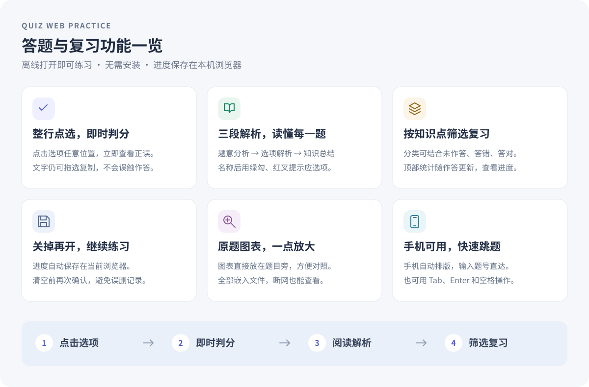

# Quiz Web Builder 题库转交互答题网页技能

一个面向 Codex 的可复用 Skill：读取用户提供的题库，识别题干、选项和答案来源，生成可离线使用的单文件答题网页。

本仓库仅提供通用技能说明、空白模板与解析辅助脚本，不包含用户题库、课程材料、题目答案、截图或生成的题库网页。

## 功能概览



**提供题库 → 识别与核对 → 生成网页 → 离线练习**

- **题库解析**：检查 Word 结构和答案标记；其他格式使用对应读取方式。扫描材料需先核对图像文字。
- **有依据的答案**：区分原文标注、公式核算和学科判定，披露答案冲突、去重与剔除情况。
- **三段式解析**：作答后依次展示题意分析、选项解析和知识总结。选项解释连为一段，选项名称后用绿勾或红叉标记。
- **完整练习交互**：整行选项可点击、文字可复制，支持即时判分、知识点筛选、错题复习、题号跳转和本机进度保存。

## 安装

下载仓库，将 `quiz-web-builder` 文件夹放入 Codex 的用户技能目录中，例如 `~/.codex/skills/`。重新加载技能后，使用 `$quiz-web-builder` 调用。

## 使用

在对话中提供题库文件，并说明：

> 使用 $quiz-web-builder，把这些题目做成可离线打开的答题网页。保留原文题干和选项，添加中文题意分析、逐项解释与知识总结，按知识点分类。

支持的模板题型为单选与判断。配对题需明确转换方式；多选题需要另外实现集合判分，不能直接套用单答案下标。

## 仓库结构

```text
quiz-web-builder/
  SKILL.md                         技能说明与质量要求
  assets/quiz-template.html         无题库数据的网页模板
  scripts/probe_docx.py             Word 结构与格式标记探查
  references/docx-structure-parsing.md
                                   解析模式、去重和常见问题
```

模板中的 `__TITLE__` 与 `__PAYLOAD__` 由技能运行时替换。网页为原生 HTML、CSS 和 JavaScript，无构建步骤或运行时外部依赖。Word 探查脚本使用 Python 标准库。

## 数据与发布范围

题库文件和由其生成的网页属于当前用户任务的输入、输出，默认只在用户指定位置处理。上传或分享本技能时，仅上传通用说明、模板、脚本和不含真实题目的示意图；不能把“上传技能”理解成允许上传用户题库或生成的练习页面。

## 验证

技能要求核对答案依据、题干和选项完整性、去重、题意与逐项解析覆盖。生成后验证数据合法性、整行点击与拖选的区分、筛选、跳转、进度保存和移动端布局。

